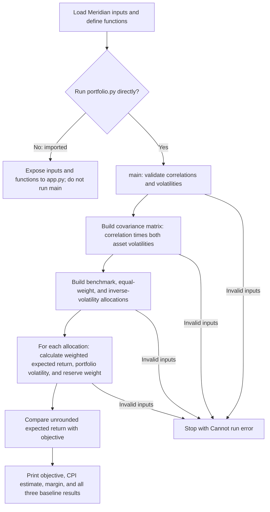
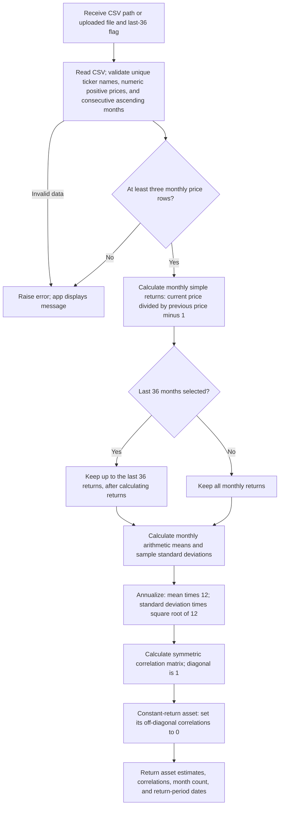
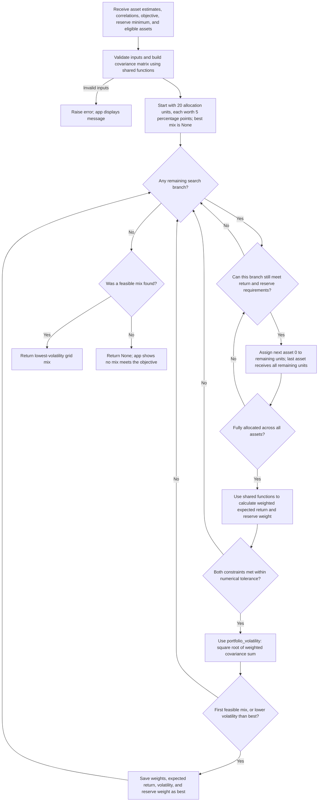

# Portfolio learning app

## Educational and research use only

This project, including its code, data, models, analyses, and outputs, is for educational and research purposes only. It does not constitute investment, financial, legal, tax, or other professional advice, or a recommendation or solicitation to buy or sell any security. Assumptions, estimates, and historical results may be incomplete or inaccurate and do not guarantee future performance. Do not rely on this project as the basis for real-world investment or financial decisions.

`app.py` imports the Meridian inputs, grid search, and CSV estimator from `portfolio.py`. This Lab 15 version includes the additions made October 22, 2026. Lab 14 retains its original engine without these additions; both versions preserve the original command-line output.

## Run from the AI Finance 2026 folder

```bash
source .venv/bin/activate
python -m streamlit run "NicolasCerioni/Project 2 FIN439/Lab 15/app.py"
```

Press Control+C in the terminal to stop the server. Streamlit is already installed in this project's `.venv`; no new dependencies were installed for this change.

## Inputs and comparison

- Without an upload, use Meridian's supplied estimates. The initial objective is 6.5% and reserve minimum is 3%; bills and the 10-year note are initially reserve-eligible.
- Upload a CSV with ISO dates first, oldest first, followed by one uniquely named column per ticker. Supply positive finite prices for the same consecutive months across all assets. Blank/missing prices, duplicate months, gaps, and unsorted dates are rejected. Use distribution-adjusted prices for total-return estimates.
- Monthly simple return = current price / previous price − 1. Expected annual return = arithmetic monthly mean × 12. Annual volatility = sample monthly standard deviation × √12. Correlations are sample correlations between synchronized monthly returns.
- The last-36 switch selects up to the last 36 returns AFTER calculating returns (36 returns require 37 price rows). The app shows the actual count. Constant-return assets use zero off-diagonal correlation by convention; zero volatility makes their covariance zero.
- Each annual return is editable; volatility and correlations come from the active window. Changing data source or window initializes new return fields. Switching windows may restore earlier edits for that window within the session.
- CSV assets initially have no reserve eligibility. Check eligible assets explicitly, or set the reserve minimum to zero for a stock-only demonstration. A check box is a user assumption, not verification of an asset's eligibility.
- Both result panels use the CURRENT objective, reserve minimum, and eligibility checkboxes. The reference uses original returns as loaded and all CSV months; the current panel uses edits and the selected window. This keeps constraints constant when comparing estimation assumptions.
- The largest weight change is the maximum absolute difference between corresponding weights, in percentage points. It is unavailable if either search is infeasible.

## Search and limits

The search covers every long-only, fully invested mix in five-percentage-point increments, including zero weights and 100% in one asset. Branches that cannot meet the return or reserve constraint are skipped. Among feasible grid mixes, it returns the one with lowest volatility using the shared engine. Equal-volatility ties retain the first candidate in deterministic insertion/increasing-weight order. A numerical tolerance of 1e-12 handles equality at a constraint.

At a 3% reserve minimum, the smallest positive reserve allocation on this grid is 5%. This finds the grid optimum, not a continuous optimum. Search size grows combinatorially with the asset count; large uploads may take time. Results are cached to avoid repeating unchanged searches.

Annualized historical arithmetic means are estimates, not forecasts or compounded growth rates. No extra cost or tax deduction is applied. Annualization does not model serial dependence. Volatility does not guarantee a maximum loss, and this app does not test all Meridian mandate rules.

## Verify

```bash
python -m unittest discover -s "NicolasCerioni/Project 2 FIN439/Lab 15" -p "test_portfolio_extensions.py" -v
```

## portfolio.py flowcharts

These diagrams follow the Lab 15 code. Running `portfolio.py` directly prints the three original baselines. Importing it from `app.py` makes its inputs and functions available without running `main()` or printing those baselines. The app calls the CSV estimator and grid search separately.

### Entry point and original terminal path



### CSV estimation path — estimate_from_csv



### Portfolio search path — search_lowest_risk_mix



The search diagram summarizes the recursive `visit()` loop: a failed branch returns to the previous allocation and tries the next one. Correlations affect portfolio volatility; they do not directly change the weighted expected return. The search considers fully invested, long-only mixes and retains the first candidate when volatilities tie.

### Compare with my paper drawing

Compare each box and decision with the path you drew on paper. Any box you did not draw becomes a question to investigate, for example: “Why does the code calculate monthly returns before selecting the last 36 months?” The diagrams describe the code; they do not claim to reproduce a paper drawing that has not been supplied.
